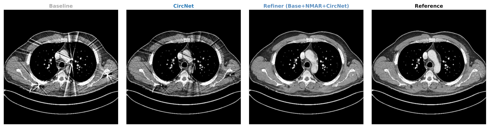

# PolMAR

**PolMAR** is a two-stage image-domain framework for metal artifact reduction (MAR) in reconstructed CT images. It requires no sinogram access and operates entirely on reconstructed slices.

> Paper: *PolMAR: A Two-Stage Metal Artifact Reduction Method with Polar-Domain Correction for Computed Tomography* — WACV 2027

## Example result



*Left to right: artifact-corrupted input → CircNet (Stage 1) → Refiner Base+NMAR+CircNet (Stage 2) → metal-free reference.*

## Overview

Metal implants cause severe streak and flare artifacts in CT that obscure surrounding anatomy. PolMAR addresses this with two complementary stages:

**Stage 1 — CircNet** (conservative polar-domain correction)
- Detects metal components and constructs a local polar coordinate system per component.
- Predicts a non-negative correction map that suppresses bright radial streaks and flares.
- Leaves the metal region unchanged by design — no hallucination of anatomy.

**Stage 2 — Refiner** (residual image-domain reconstruction)
- A residual U-Net that takes the artifact-corrupted image as input together with up to three auxiliary priors:
  - **CircNet output** — the polar-corrected image.
  - **NMAR** — a classical sinogram-free normalised MAR prior.
  - **SEG** — a semantic segmentation map produced by nnU-Net and refined via graph-based label propagation in bloom-affected regions.
- Predicts a residual correction applied only outside the metal mask (hard-paste formulation), preserving the original metal voxels.

```
Artifact CT ──► CircNet ──► Corrected image ──┐
                                               ├──► Refiner ──► Final output
                    NMAR ─────────────────────┤
                    SEG ──────────────────────┘
```

### Key results

| Dataset       | Model            | MAE (HU) | RMSE (HU) | SSIM  |
|---------------|------------------|----------|-----------|-------|
| AAPM CT-MAR Body | Artifact baseline | 46.82  | —         | —     |
| AAPM CT-MAR Body | Refiner (Base+CircNet) | **< 18** | — | ↑ |
| Jitter vol. 4 | Artifact baseline | 39.94  | —         | —     |
| Jitter vol. 4 | Refiner (Base+CircNet) | **16.30** | — | ↑ |

## Repository structure

```
polmar/
├── model.py                     # CircNet architecture (Stage 1 dependency)
├── dataset.py                   # Shared dataset utilities
├── loss.py                      # CircNet loss
├── inference.py                 # CircNet inference helper
│
├── circnet_refiner_train.py     # Refiner training: Base + CircNet prior
├── jitter_refiner_train.py      # Refiner training: Jitter dataset
├── circnet_refiner_metrics.py   # Refiner evaluation (AAPM)
├── jitter_refiner_metrics.py    # Refiner evaluation (Jitter)
│
├── nmar_inference.py            # NMAR prior computation
├── graph_channel_generator.py   # SEG channel generation (nnU-Net + graph propagation)
│
├── circnet_jitter_inference.py  # CircNet inference on Jitter test set
├── real_circnet_inference.py    # CircNet inference on real hospital data
├── real_refiner_inference.py    # Refiner inference on real hospital data
├── visualize_real_results.py    # Visualisation of real-data results
│
├── compute_metrics.py           # MAE / RMSE / PSNR / SSIM / Grad-MAE computation
├── collect_metrics.py           # Batch metrics collection across runs
├── rotate_raw.py                # .raw file rotation utility
│
├── stats/
│   ├── statistical_analysis.py  # Paired Wilcoxon + bootstrap CI analysis
│   └── metrics_refiner_*.csv    # Per-slice evaluation results (all variants)
│
└── slurm/                       # SLURM scripts for Helios / PLGrid
    ├── run_train.sh              # CircNet training
    ├── run_refiner.sh            # Refiner training (generic)
    ├── run_refiner_jitter.sh     # Refiner: Jitter dataset
    ├── run_refiner_jitter_circnet.sh
    ├── run_refiner_body689.sh    # Refiner: AAPM body
    ├── run_nmar_inference.sh     # NMAR prior generation
    ├── run_graph_jitter.sh       # SEG channel generation (Jitter)
    ├── run_graph_body689.sh      # SEG channel generation (AAPM)
    ├── run_metrics.sh
    ├── run_metrics_jitter.sh
    ├── run_real_inference.sh     # Full pipeline on real hospital data
    ├── convert_real_raw_to_nifti.sbatch
    ├── predict_real_seg.sbatch
    ├── run_real_seg_channels.sbatch
    └── run_real_visualization.sbatch
```

## Requirements

```bash
pip install -r requirements.txt
```

Key dependencies: `torch>=2.0`, `nibabel`, `scipy`, `scikit-image`, `pandas`, `matplotlib`.

For the SEG module, a trained [nnU-Net](https://github.com/MIC-DKFZ/nnUNet) model is required (Dataset 701, 2D config, trained on CT-ORG).

## Data format

CT slices are stored as flat binary `.raw` files (float32, C-order):

```
<prefix>_H<height>_W<width>.raw
```

Real hospital data is additionally converted to NIfTI (`.nii.gz`) for nnU-Net segmentation. Use `slurm/convert_real_raw_to_nifti.sbatch` for batch conversion.

## Training the Refiner

```bash
python jitter_refiner_train.py \
  --art-dir      /path/to/jitter/artifact/slices \
  --clean-dir    /path/to/clean/slices \
  --circnet-dir  /path/to/circnet/output \
  --output-dir   /path/to/refiner/runs \
  --base-features 128 \
  --train-scan-ids 1 2 3 4 5 6 7 \
  --val-scan-ids 8 9
```

To include the SEG channel:
```bash
  --seg-chan-dir /path/to/seg_channels
```

## Running the full pipeline on new data

```bash
# Step 1: CircNet inference
python real_circnet_inference.py \
  --model-path /path/to/circnet/best_model.pth \
  --input-dir  /path/to/raw/slices \
  --output-dir /path/to/circnet_output

# Step 2: Refiner inference
python real_refiner_inference.py \
  --model-path  /path/to/refiner/best_refiner.pth \
  --art-dir     /path/to/raw/slices \
  --circnet-dir /path/to/circnet_output \
  --output-dir  /path/to/refiner_output \
  --base-features 128
```

See `slurm/run_real_inference.sh` for the full SLURM pipeline (CircNet → Refiner Base+CircNet → Refiner Base+CircNet+SEG).

## Statistical analysis

Pre-defined paired comparisons from the WACV paper:

```bash
cd stats/
python statistical_analysis.py
```

Outputs:
- `paired_statistical_results.csv` — full numerical results
- `paired_statistical_results.tex` — LaTeX table ready for the paper
- `figures/diag_*.pdf` — per-comparison distributions of paired differences

Six tests: Base vs Base+CircNet (MAE, RMSE) on Jitter and AAPM; Base+NMAR vs Base+NMAR+SEG (SSIM, Grad-MAE) on Jitter. All six comparisons are statistically significant after Holm–Bonferroni correction (p < 0.001).

## License

© 2026 Bartosz Lewandowski. Free for non-commercial use (research, academic, personal).
Commercial use requires a written license — contact **barteklew123@gmail.com**.
See [LICENSE](LICENSE) for full terms.

## Citation

If you use PolMAR in your work, please cite the master's thesis:

```bibtex
@mastersthesis{lewandowski2026,
  title  = {Metal artifact reduction in computed tomography images},
  author = {Lewandowski, Bartosz},
  school = {Wrocław University of Science and Technology,
            Faculty of Information and Communication Technology},
  year   = {2026},
  month  = {7},
  type   = {Master's thesis}
}
```
